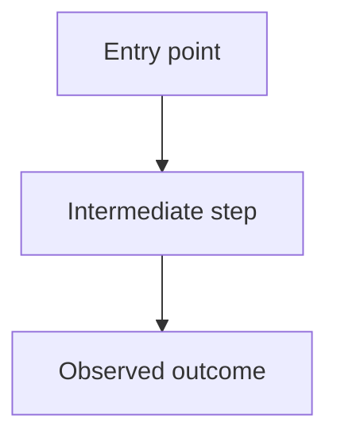

# Cross-Repository Investigation — REPLACE ME

## Problem statement

## Scope and non-goals

## Repositories and version matrix
| Repository | Role in flow | Commit/tag | Source links |
|---|---|---|---|

## Summary

## End-to-end flow

Replace example nodes with evidence-backed symbols and paths.

## Call chain
| Step | Caller | Callee | Inputs / outputs | Evidence |
|---|---|---|---|---|

## Data and state flow

## Evidence matrix
| Claim | Evidence level (A/B/C/U) | Validation state | Supporting sources |
|---|---|---|---|

## Experiments and runtime validation

## Alternative explanations / conflicting evidence

## Limitations and unknowns

## Related reports

## Follow-up tasks
- [ ]
